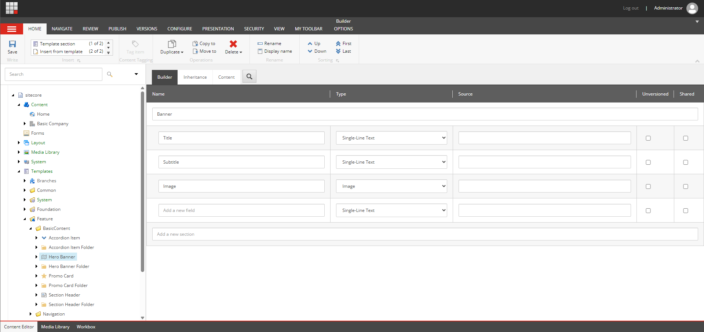
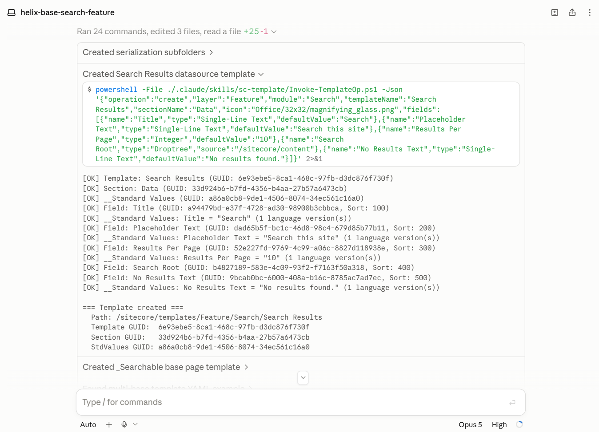
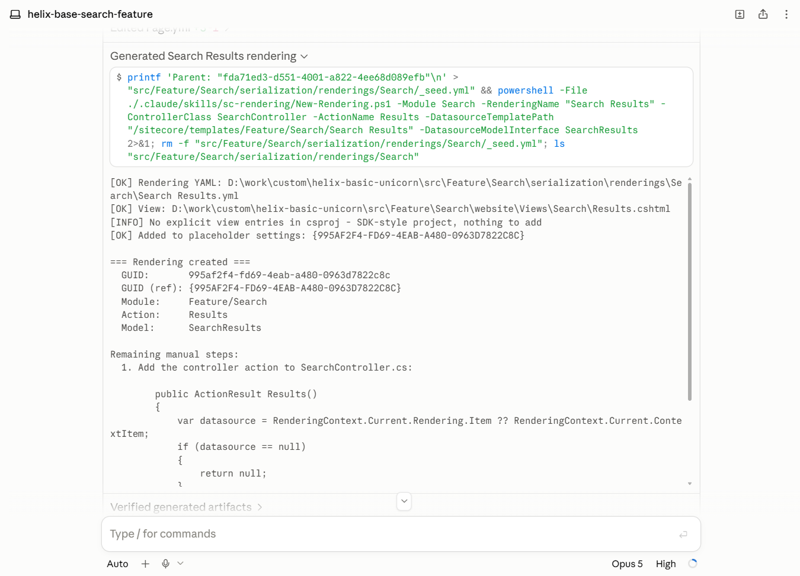
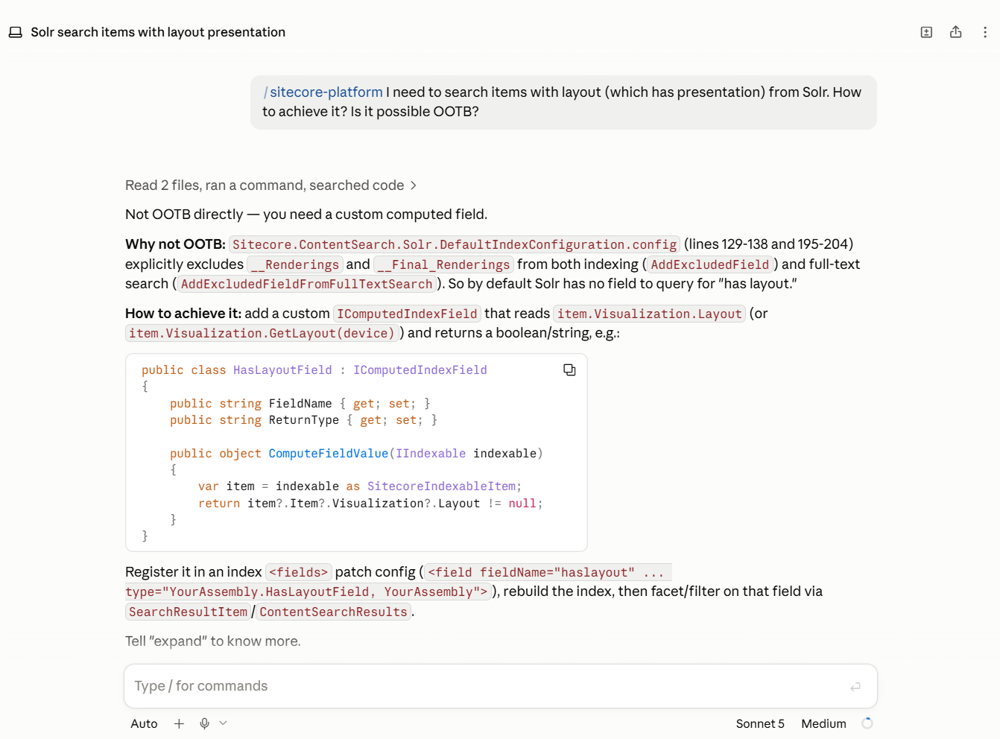

In this article, I explain how I extended Claude Code to work better with Sitecore XP.

## TL;DR

The full setup (skills, scripts and hooks) is in
[izharikov/sitecore-xp-skills](https://github.com/izharikov/sitecore-xp-skills).


## Sitecore XP development with Claude

On its own, [Claude Code](https://code.claude.com/docs/en/features-overview) already handles the codebase.
Sitecore XP is harder than a typical open-source stack.

> Coding agent limitations with Sitecore XP:

- closed platform - no public source; behaviour is compiled into shipped assemblies
- limited public material - sparse docs and examples next to a stack like Next.js
- state lives in a database - content, templates and renderings reach Git only through serialization
- variety of configs - Sitecore ships with thousands of configuration files and settings, hard to locate without knowing where to look


## Setup

### CLAUDE.md

[Claude Memory](https://code.claude.com/docs/en/memory) starts with the _CLAUDE.md_ file. Keep it short, but enough for Claude Code to understand your project.

For a project CLAUDE.md I usually include this Sitecore-related information:
- Sitecore version and project architecture (e.g. 10.4.1 and Helix)
- serialization: Unicorn, Sitecore Content Serialization (SCS), TDS, etc.
- code generation tool: Leprechaun, T4 templates, etc.
- build process: e.g. a build script the agent can run to verify work (or an explicit rule against running the build)
- unit test policy
- general code rules important for most Claude Code sessions

### Templates and renderings

> Every tool works on local files under version control.

The alternative to a local skill is an MCP server wired to a live instance, like
the [Sitecore Community MCP server](https://github.com/Antonytm/mcp-sitecore-server).

#### Skill vs MCP for item editing

| | Skill | MCP |
|---|---|---|
| Changes land in | source files under Git | the live instance |
| Review | diff in a pull request | none |
| Revert | like any other commit | manual fix |
| Sitecore running | not needed | required |
| Feedback loop | build and sync first | immediate |

#### Templates

Template creation is usually a **manual process** done in the Content Editor: here a developer adds the template, its
sections, then every field, one by one.



After that, Sitecore serializes it to files on disk, so it
can be shared and deployed. For Claude Code I change the direction:

> [`/sc-template`](https://github.com/izharikov/sitecore-xp-skills/blob/main/skills/sc-template/SKILL.md) skill:
>
> Edit the YAML locally and sync it back into
Sitecore, so a template change is a file change.


```txt
before (manual):  [developer]  Sitecore   -> serialize -> repository
now (automated):  [agent]      repository -> sync      -> Sitecore
```

To simplify the process and save tokens, it's wrapped in a PowerShell script:

```powershell
powershell -File .\.claude\skills\sc-template\Invoke-TemplateOp.ps1 -Json '{
  "operation": "create", "layer": "Feature", "module": "Article",
  "templateName": "Article Page", "sectionName": "Data",
  "fields": [
    { "name": "Title", "type": "Single-Line Text" },
    { "name": "Body", "type": "Multi-Line Text" },
    { "name": "Summary", "type": "Multi-Line Text" }
  ]
}'
```

The skill calls it:



_Note_: Unicorn and SCS both work here - only the file format changes.

#### Renderings

Creating a rendering touches even more places than a template. By hand the routine is:

- add the rendering item
- point it at a datasource template
- register it on the placeholders it is allowed in
- write the controller action
- write the Razor view

**Five manual edits** across the Content Editor and the codebase, and they all have to line up.

For the agent I use the same approach as for templates:

> [`/sc-rendering`](https://github.com/izharikov/sitecore-xp-skills/blob/main/skills/sc-rendering/SKILL.md) skill:
>
> Create the rendering locally (file edits), then deploy code and sync Unicorn so the rendering exists in Sitecore.

_Note_: shown with Unicorn - other serialization tools work with adjustments.

The skill wraps it in one script call:

```powershell
powershell -File .claude/skills/sc-rendering/New-Rendering.ps1 -Module Accordion `
  -RenderingName "Accordion Container" `
  -ControllerClass AccordionController -ActionName Container `
  -DatasourceTemplatePath "/sitecore/templates/Feature/Accordion/Accordion Container" `
  -DatasourceModelInterface IAccordionContainer
```




#### Content Editing

Content editing itself I do not automate yet. The same serialization approach applies (edit the YAML file locally for a page or datasource and sync), or
an MCP server against a running instance (see above).

### SPE scripting with an LLM

[Sitecore PowerShell Extensions (SPE)](https://doc.sitecorepowershell.com/) is widely used, and the agent can generate SPE scripts.

While in most cases it works, sometimes the agent hallucinates: SPE cmdlets read like ordinary PowerShell but are a separate set, so it writes a plausible name or
parameter that does not exist. There is no compile step - the script fails only when it runs in a Sitecore instance.

> [`/spe`](https://github.com/izharikov/sitecore-xp-skills/blob/main/skills/spe/SKILL.md) skill:
>
> Verify PowerShell commands and parameters against existing documentation.

SPE documentation is comprehensive and easily machine-accessible in markdown format:

```txt
https://doc.sitecorepowershell.com/appendix/<category>/<lowercase-command>.md
```

_Task_: create a user with a full name and client language.

<div class="my-6 w-full overflow-x-auto">
<table class="stack-mobile w-full border-collapse border border-border">
<thead>
<tr>
<th>Without Skill</th>
<th>With Skill</th>
</tr>
</thead>
<tbody>
<tr>
<td>
⚠️ Issues
</td>
<td>
✅ Works
</td>
</tr>
<tr>
<td>

- Full name is not set
- To set profile properties `-Authenticated` is required
</td>
<td>

- Full name is set
- Uses `-Authenticated`
</td>
</tr>
<tr>
<td>

```powershell
# --- Create user ---
New-User -Identity $username -Enabled $true `
    -Password $password -Email $email

# --- Set profile properties ---
$user = Get-User -Identity $username
$user.Profile.FullName       = $fullName
$user.Profile.ClientLanguage = $clientLanguage
$user.Profile.Save()
```

</td>
<td>

```powershell
$user = New-User -Identity $domainQualifiedName -Enabled `
    -Password $password -Email $email -FullName $fullName

$user = Get-User -Identity $domainQualifiedName -Authenticated
$user.Profile.ClientLanguage = $clientLanguage
$user.Profile.Save()
```

</td>
</tr>
</tbody>
</table>
</div>

### Sitecore configs and internals

Not every Sitecore internal is searchable in the docs. Some answers - which processors a pipeline
runs, what a setting defaults to - live only in the shipped configuration, and none of that is on
the public web.

Checking it usually means visiting `/sitecore/admin/showconfig.aspx` and searching for the required pipeline/config (but often it's unclear what to search for). Unzip a Sitecore installation locally, give Claude Code access, and it greps the configs for you.

> [`/sitecore-platform`](https://github.com/izharikov/sitecore-xp-skills/blob/main/skills/sitecore-platform/SKILL.md) skill:
>
> Access to a Sitecore installation: browse configs and XMLs, and decompile DLLs when needed.

_Example_: can the search index return only page items (items with presentation)?



### DLL decompilation

A developer who wants to know how a library really works decompiles it - Rider does it on a click,
Visual Studio with ReSharper too.

[ILSpy](https://github.com/icsharpcode/ILSpy) is an open-source decompiler. It
ships a command-line tool, `ilspycmd`, that turns a compiled assembly back into C# and prints it -
no GUI, no project loaded:

```bash
dotnet tool install -g ilspycmd
ilspycmd path/to/Library.dll
```

I wrapped that in a skill: Claude runs it against an assembly and reads the source.

> [`/ilspy-decompile`](https://github.com/izharikov/sitecore-xp-skills/blob/main/skills/ilspy-decompile/SKILL.md) skill:
>
> Understand internals of the system by decompiling DLLs.

_Note_: check the license of the assembly before you decompile it. Terms differ per vendor, and
for a commercial product they usually restrict reverse engineering.

### Hooks

_CLAUDE.md_ and every loaded skill add to the context on every request. Consider wrapping anything deterministic into hooks.

| Extension | What for |
|---|---|
| CLAUDE.md | context the model needs every session |
| Skill | a multi-step operation, loaded only when needed |
| Hook | anything a machine can check or fix |

[Formatting](https://github.com/izharikov/sitecore-xp-skills/blob/main/hooks/Format-CSharpFile.ps1) is the clearest case. The rules are already in `.editorconfig`; a hook reapplies them
after each write - no added context, and it can't be skipped.

## Conclusion

> Claude Code already works with the Sitecore XP codebase.
>
> With skills it's more predictable and has better Sitecore context.

Templates, renderings, and Sitecore internals follow the same shape:

- templates and renderings go through a skill
- SPE cmdlets get checked live against the documentation
- agent has access to Sitecore internals

If you have built something similar for your Sitecore solution, or found a better shape for any of
these skills, let me know ([email](mailto:zharikovigor97@gmail.com) me or find me in Sitecore Slack).
